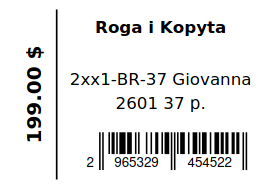

# Barcode Labels Generator

Generate EAN-13 barcodes, printable PDF labels, and XLSX files with a barcode column.

## Features

- Sequential EAN-13 barcode generation with SQLite storage
- Reuse of valid EAN-13 barcodes already present in Excel
- Profile-based processing for shoes and bags
- Configurable Excel column mappings and label layouts
- Optional store logo, brand, color, and product size
- Quantity-based printing (multiple labels per product)
- Validation of required Excel columns and existing barcodes
- PDF labels (58 × 40 mm) and XLSX export

## Setup

Create a virtual environment:

```bash
python3 -m venv venv
```

Activate it on Linux/macOS:

```bash
source venv/bin/activate
```

Or on Windows:

```bat
venv\Scripts\activate
```

Install dependencies:

```bash
pip install -r requirements.txt
```

## Profiles

Two profiles are available: `shoes` and `bags`.

Profile configuration is located in `config/profiles/`:

```text
config/profiles/
├── bags.example.json
├── bags.json           # Optional, local configuration
├── shoes.example.json
└── shoes.json          # Optional, local configuration
```

The application loads `<profile>.json` when it exists; otherwise it falls back to `<profile>.example.json`. The example profiles can be used without creating private configuration files.

Local `bags.json` and `shoes.json` files are excluded from Git. To customize a profile, copy the corresponding example file and edit the copy.

Profiles configure the Excel column names, label layout, store name, and the fields used to identify and display products. The available layout names are:

- `label_58x40_vertical_price`
- `label_58x40_shoes`
- `label_58x40_bags`

See `config/profiles/*.example.json` for the actual column mappings and profile settings.

### Optional store logo

A profile can specify an external PNG logo:

```json
"logo_path": "assets/logo.png"
```

When `logo_path` is `null`, the label uses the configured store name instead. A private `assets/logo.png` can be kept outside Git and copied into the `assets/` directory of a Windows distribution alongside private profile files. No executable rebuild is needed to change these external files.

## Input XLSX Format

The first row must contain column headers. Their names are defined by the selected profile's `columns` mapping, so they do not need to match internal names such as `article`, `price`, or `barcode`.

Required columns are determined by:

- `product_key_fields`
- `label_item_fields`
- `price`
- `currency`

Other mapped columns may be omitted. In particular, an input file does not need a barcode column when generating labels for the first time.

Example validation error:

```text
Required column 'price' not found in Excel file
```

### Quantity

If the profile maps a `quantity` field, its Excel value controls how many identical PDF labels are printed for each row:

| Quantity | PDF labels |
| --- | ---: |
| Empty or missing | 1 |
| `0` | 0 |
| `2` | 2 |
| `3` | 3 |

Quantity must be a non-negative whole number. Invalid values (such as `-1`, `1.5`, or text) cause an error. A barcode is still assigned to a processed row when its quantity is zero.

## Run

Run the default demo:

```bash
python3 main.py
```

Select a profile:

```bash
python3 main.py --profile shoes
python3 main.py --profile bags
```

Specify input and output files:

```bash
python3 main.py \
    --profile shoes \
    --input input/products.xlsx \
    --output output/products_with_barcodes.xlsx
```

The command produces:

```text
output/
├── products_with_barcodes.xlsx
└── products_with_barcodes.pdf
```

The XLSX file contains the assigned barcodes, and the PDF contains the printable labels.

## Barcode Generation and Reprinting

The application uses EAN-13 barcodes with a configurable prefix (default: `29`). New barcodes are generated from an increasing sequence stored in `data/barcodes.sqlite3`.

For each Excel row:

1. If the mapped barcode cell contains a valid EAN-13 value, reuse it.
2. If the cell is absent or empty, generate a new EAN-13 barcode.
3. If the cell contains an invalid barcode, stop with an error identifying the Excel row.

Existing values must contain exactly 13 digits and have a valid EAN-13 check digit.

**The database is a sequence allocator, not a product-to-barcode registry.** Reprocessing the same product from an Excel file *without* a barcode creates a new value. To reprint previous labels, use the XLSX generated by an earlier run, or another Excel file containing those same barcodes.

Example:

```bash
python3 main.py \
    --profile bags \
    --input output/bags_with_barcodes.xlsx \
    --output output/bags_reprinted.xlsx
```

This preserves the existing barcodes while allowing labels to be rendered again. Changes to price or quantity do not change an existing barcode.

**Keep `data/barcodes.sqlite3` when generating new barcodes.** Removing it resets the sequence and can result in previously issued values being generated again. The database does not need to contain an existing barcode for that value to be reused from Excel.

## Label Example



## Price Formatting

Prices are formatted automatically:

```text
10990 + UAH -> 10 990.00 грн
199 + USD -> 199.00 $
199 + PLN -> 199.00 PLN
```

Currency symbols include EUR (`€`), RUB (`₽`), UAH (`грн`), and USD (`$`). Unknown currency codes are displayed unchanged.

## Tests

Run tests:

```bash
pytest
```

Run tests with coverage:

```bash
python -m pytest -p pytest_cov --cov=src --cov-report=term-missing
```

## License

This project is licensed under the GNU Affero General Public License v3.0.
